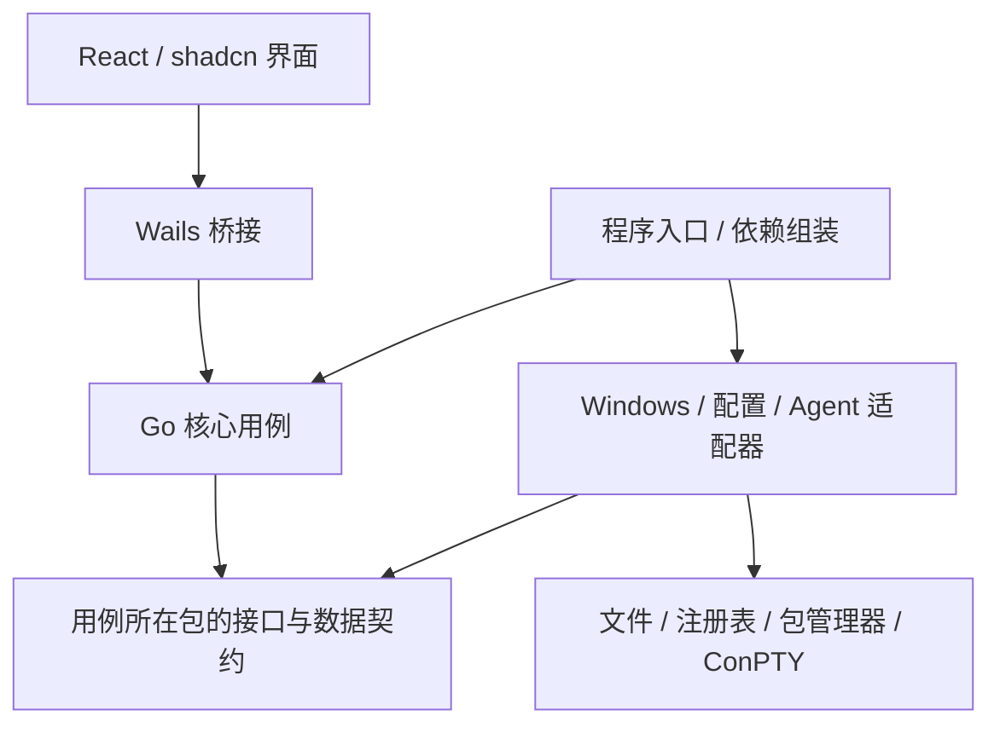
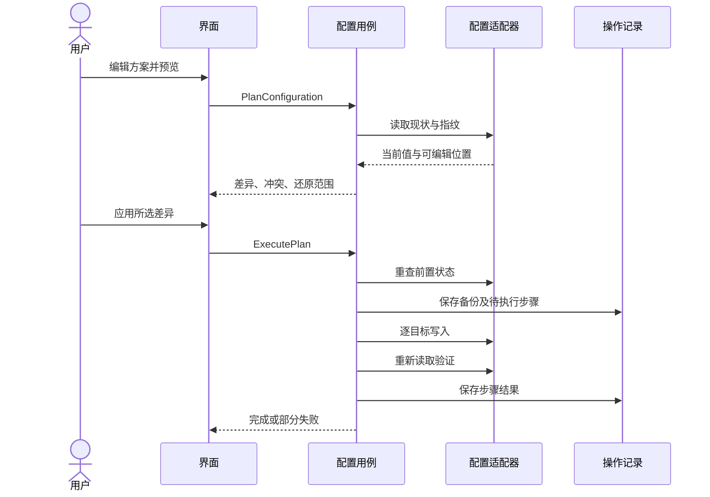
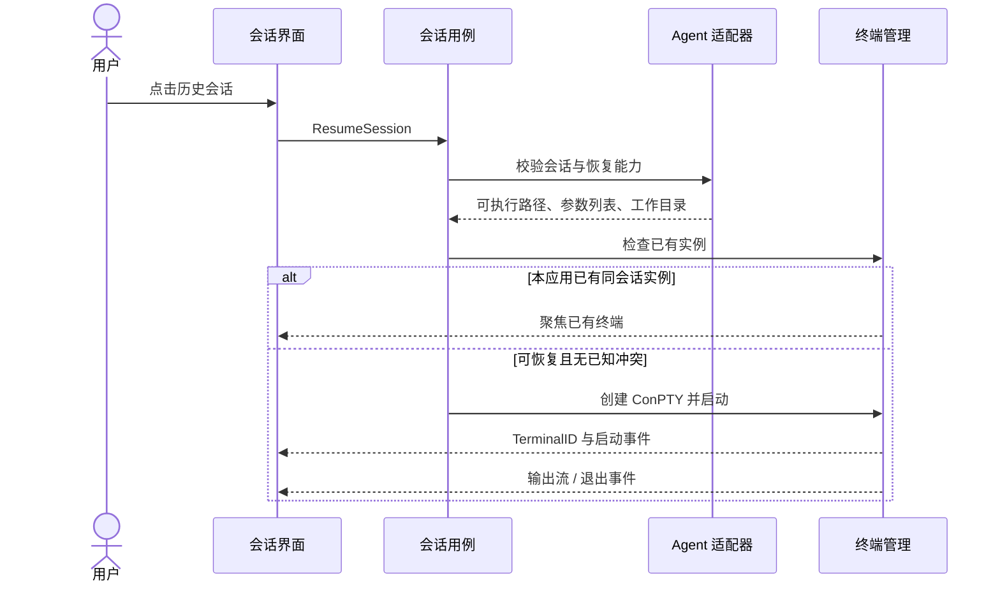

# Shuttle 工程架构契约草案

状态：首版产品范围已于 2026-10-24 经用户确认；技术接口仍为草案，Wails 版本及终端通道待验证。本文不代表实现已经完成。

## 1. 产品目标与已定技术

安装 Shuttle 后，用户可以检测终端工作环境、选择手动或自动安装缺失项、编辑并应用个人配置，并跨工作区恢复 Agent 会话。配置修改可追溯、可还原；移除 Shuttle 不应让原有终端失效。

- 后端：Go。
- 前端：React、TypeScript、Vite、Tailwind CSS、shadcn/ui；优先复用已有组件。
- 桌面容器候选：Wails，版本待 Windows 终端验证后锁定。
- 首版必须内嵌真实终端；实现候选为 xterm.js + Windows ConPTY，需完成实机验证。
- 首版 Agent：Claude Code 和 Codex，均须完成检测、跨工作区会话发现与恢复；pi 后续扩展。
- 首版平台：Windows 11；其他平台暂不承诺。

### 已确认的首版范围

| 项目 | 首版包含 | 验收边界 |
|---|---|---|
| 桌面工作台 | 内嵌 PowerShell、Claude Code、Codex 终端 | 中文输入、复制粘贴、字体缩放、终端尺寸调整可用 |
| 外部终端入口 | 在 Windows Terminal 中打开工作区 | 目录正确；不接管或聚焦外部运行中的会话 |
| 关闭行为 | 有运行中终端时提示退出；取消则保留窗口，确认后终止受管终端并等待退出 | 不做托盘保活或后台守护；安装/配置操作按安全检查点处理 |
| 环境检测 | PowerShell 7、Git、Windows Terminal、Node.js、Claude Code、Codex、WebView2 | 展示状态、版本、路径及失败原因；不强制安装 Node.js 等可选运行条件 |
| 安装与卸载 | 手动安装指引、可选自动安装、按归属安全卸载 | 自动安装先展示范围与权限，完成后复检；已有软件不重复安装 |
| 配置管理 | WT、PowerShell Profile、Claude 状态栏、可选字体 | 用户选项、差异预览、合并、操作记录与一键还原；冲突不静默覆盖 |
| Agent 接入 | Claude Code 与 Codex | 两者各自验收发现、恢复及内部终端去重；不支持的元数据明确标记 |

配置字段范围：WT 主题、字体、默认 Profile、Shuttle 管理的 Profile、用户选择的快捷键与终端参数；PowerShell 会话入口与历史预测；可选 Claude 状态栏预设。已有配置先检测冲突，不接管整个文件。字体按选定字重安装，不默认下载全部字重。Starship 首版只保留现状，不自动安装或配置。

Codex 首版支持安装检测、手动/自动安装路径、会话发现和恢复；不因此默认修改其模型、认证或其他配置。两种 Agent 均使用原有认证流程。

首版排除：pi、第三方插件运行时、插件市场、配置云同步、后台会话保活，以及跨平台发行。

## 2. 进程与依赖边界

首版一个桌面应用进程，按需启动 shell/Agent 子进程，不引入常驻守护进程、云服务或独立本地 HTTP API。

运行时核心调用注入接口；源码中核心不 import 具体适配器。入口负责创建适配器并注入核心。接口先定义在使用它的核心包中，不提前创建全局 protocols 包。

| 模块 | 负责 | 不负责，归属何处 |
|---|---|---|
| frontend/features | 展示、输入校验反馈、转发用户意图 | 安装命令与合并规则归 core/adapters |
| bridge | 参数转换、调用核心、转发结构化事件 | 状态转换与任务调度归 core |
| core/environment | 检测结果、安装计划、安装后验证 | 包管理器调用归 adapters/windows |
| core/configuration | 差异计划、应用、冲突检测、还原 | JSONC/Profile 文件编辑归 adapters/configuration |
| core/sessions | 工作区分组、会话去重、恢复用例 | Agent 文件格式与命令归 adapters/agents |
| core/terminal | 终端生命周期、会话与终端关联 | ConPTY 与管道细节归 adapters/windows |
| 操作记录存储 | 步骤、备份、归属证据、恢复检查点 | 会话正文仍归原 Agent；不复制到操作记录 |

## 3. 核心数据与所有权

标识分别命名，不混用：WorkspaceID、AgentID、SessionID、TerminalID、PlanID、OperationID。

- SessionRef：AgentID + 原生 SessionID + 工作目录。历史会话不等于存活进程。
- TerminalInstance：TerminalID、关联会话（可空）、PID、状态、退出码（可空）。
- Detection：检查项标识、状态（available/missing/unsupported/unknown）、版本、路径、可解释的原因。检查失败不能冒充 missing。
- UserProfile：带 schemaVersion 的个人配置方案；可导入导出，不含本机安装归属记录，不默认包含凭据。
- ChangePlan：PlanID、操作类型、目标、前置状态指纹、逐项差异、依赖、所需权限、可还原范围。
- Operation：OperationID、PlanID、逐步状态、备份引用、执行结果、人工处理项。

软件检测结果与安装归属分开保存。仅凭 PATH 中出现一个程序不能证明是 Shuttle 安装的。每次安装记录安装前后证据、包标识、版本及安装器结果；证据不足则禁止自动卸载。

配置方案可迁移；备份、安装记录、绝对路径与操作状态只属于本机。凭据不写入方案、日志或事件；使用 Agent 自己的认证流程，不复制其令牌。

初始存储建议：本机应用数据目录中的版本化 JSON、每次操作独立目录和受限访问的备份。写入使用临时文件替换；多进程访问以文件锁保护。不提前引入数据库。

## 4. 用例接口草案

以下是语言无关签名，不是最终 Go/Wails 声明。Result 中包含结构化错误；事件只是展示通知，持久记录才是最终依据。

| 接口 | 结果与约束 |
|---|---|
| DetectEnvironment() | Detection[]；只读，无安装副作用 |
| PlanInstall(componentIDs) | ChangePlan；提供官方手动安装说明及可用自动安装路径 |
| PlanConfiguration(profile) | ChangePlan；不写配置；展示新增、修改、删除及冲突 |
| PlanRestore(operationIDs) | ChangePlan；校验当前值、原值、已写入值并识别冲突 |
| PlanUninstall(componentIDs) | ChangePlan；只接受归属可证且依赖检查通过的组件 |
| ExecutePlan(planID, choices) | OperationID；重查前置状态，过期计划返回 stale_plan |
| GetOperation(operationID) | 已持久化的步骤、状态、结果及恢复入口 |
| RequestCancel(operationID) | 请求取消；不是保证底层安装器立即终止 |
| ListWorkspaces() | 工作区与汇总 |
| ListSessions(workspaceID, agentID?) | 元数据；默认不读取完整对话正文 |
| ResumeSession(sessionRef) | TerminalID；目录、Agent、能力验证通过后启动 |
| StartTerminal(workspaceID, shellID) | TerminalID；创建普通 shell |
| ResizeTerminal(terminalID, cols, rows) | 校验正数与实例状态后调整 |
| CloseTerminal(terminalID, confirmed) | 执行明确的终止流程；活跃实例需用户确认 |

终端输入/输出独立于上述请求响应接口，使用选定容器支持的流式通道。需验证批量输出、缓冲上限、背压、UTF-8 分片和退出后排空；禁止逐字符进入 React 全局状态。终端输出可能包含凭据，默认不持久录制。

统一错误至少区分：validation_failed、not_found、unsupported、permission_required、conflict、stale_plan、busy、external_failure。包含步骤标识与可操作原因，不将底层错误静默吞掉。

## 5. 配置应用与还原

不同文件必须有不同合并策略，禁止通用递归 JSON merge：

- WT JSONC：保留注释和无关设置；Profile 按 GUID 匹配，主题按名称匹配，快捷键按明确身份规则处理。具体数组规则需在实现前用样本冻结。
- PowerShell Profile：带唯一管理标识的代码块；已有同类功能先检测冲突，不重复注入。多次应用不得重复添加。
- Agent 配置与状态栏：仅管理用户选中的字段/文件，预览原有接入方式；不覆盖凭据，不假定各 Agent 格式相同。

单文件替换只能承诺该文件的写入边界；跨文件、注册表、安装器不具备整体原子事务。失败保留每步结果，自动恢复也必须经过冲突检查。启动时发现未完成操作，先核对实际状态，再提供继续或还原入口，不盲目重复安装。

### 三方还原规则

对每个受管字段/块保存应用前值 O、Shuttle 写入值 A，恢复时读取当前值 C；缺失本身也是一种值。

| 当前状态 | 默认动作 |
|---|---|
| C = A | 还原 O；O 原本缺失则仅删除该受管内容 |
| C = O | 已还原，跳过 |
| C 与 O、A 均不同 | 冲突，默认保留当前值；允许预览后单独选择恢复 |
| 文件丢失或结构无法识别 | 报告人工处理项，不整文件强写 |

整体备份恢复是额外选项，必须展示覆盖范围，并再次备份当前文件。共享文件不因 Shuttle 创建过就无条件整文件删除。

### 卸载安全顺序

1. 生成配置还原和依赖检查计划，用户选择范围。
2. 先修复将引用待卸载软件的默认 Profile、启动命令和受管配置。
3. 冲突未解决则阻止卸载相应组件，不阻止无关项处理。
4. 仅卸载归属明确、用户选中的组件；不自动级联卸载共享依赖。
5. 重新检测保留的 shell 及配置引用，记录结果。

卸载 Shuttle 应用本体与清理环境分别提供入口。正常卸载默认保留用户数据；彻底移除须先处理未完成操作并明确确认备份删除。权限提升仅限需要的安装步骤，桌面应用默认普通权限运行。

## 6. 会话恢复与终端生命周期

启动使用可执行路径和参数数组，不拼接 shell 命令字符串。工作目录必须存在且用户可访问；移动/删除的工作区返回错误，允许重新定位后再尝试。

首版只承诺聚焦本应用拥有的终端。外部终端的活动状态来自 Agent 可验证的数据；无法可靠判断时显示 unknown，不按文件更新时间猜 busy/idle。已知外部会话正在使用则提示冲突，不自动创建第二个写入同会话的进程；检测结果存在竞态，不能宣称全系统互斥。

关闭标签前提示仍在运行的进程。首版不承诺退出 Shuttle 后保活；关闭主窗口需提示终止范围，按顺序关闭 ConPTY 与子进程并等待退出。意外崩溃不承诺无残留，启动时检测可识别的遗留状态，禁止按进程名批量结束进程。

## 7. 状态转换

| 对象 | 当前状态 | 事件 | 下一状态 |
|---|---|---|---|
| 计划 | draft | 完成检测与差异计算 | ready / blocked |
| 计划 | ready | 执行前检测发现外部变化 | stale |
| 操作 | pending | 获取资源锁、写入执行记录 | running |
| 操作 | running | 所有步骤验证成功 | succeeded |
| 操作 | running | 部分步骤完成后失败 | partially_failed |
| 操作 | running | 首个有效步骤前失败 | failed |
| 操作 | running | 请求取消 | cancelling |
| 操作 | cancelling | 到达安全检查点并停止 | cancelled |
| 操作 | running/cancelling | 应用意外退出后重新发现 | interrupted |
| 操作 | interrupted | 核对现状并生成新计划 | 保留旧记录；执行新操作 |
| 终端 | starting | 子进程启动成功 | running |
| 终端 | starting | 启动失败 | failed |
| 终端 | running | 请求关闭 | stopping |
| 终端 | running/stopping | 确认进程退出 | exited |

取消可能保留已成功步骤，界面必须列出；不能把 cancelled 展示为已还原。相同配置目标的写操作互斥，不相关的只读检测可以并行。

## 8. Agent 扩展契约

Agent 适配器提供 Detect、Capabilities、ListSessions、BuildLaunchSpec。会话解析与配置格式各自归属适配器；配置写入必须通过统一计划和操作记录流程。

Capabilities 明确列出 resume、activity、modelMetadata 等支持情况。未知能力不伪造，单个 Agent 损坏的记录不阻断其他 Agent 列表，必须汇总可见的读取错误。

首版内置注册表，分别实现 Claude Code 与 Codex 适配器。用两者真实差异验证契约；会话标识使用 AgentID + SessionID，避免跨 Agent 冲突。第三方 npm/Bun 运行时、权限沙箱、插件市场和前端动态插件不实现。后续 pi 接入时再扩展必要接口，不提前为未知 Agent 增加字段。

## 9. 前端工程边界

- frontend/src/app：应用布局、导航、主题。
- frontend/src/components/ui：shadcn/ui 基础组件，保留可访问性行为。
- frontend/src/features/{environment,configuration,sessions,terminal}：功能组合与页面状态。
- frontend/src/lib：桥接客户端、通用工具。
- 后端结果和操作状态以 Go 为准；前端保留表单草稿、选择、展开状态等交互数据。
- 桥接类型尽量生成；无法生成的流式消息单独维护版本化契约。
- 首版不预装全局状态框架，按真实跨组件需求引入。

## 10. 验收与交付清单

- [ ] 在无 pwsh7/Node/Python 的目标 Windows 环境启动应用并运行只读检测；桌面 WebView2 条件明确展示。
- [ ] Wails + xterm.js + ConPTY 实测 PowerShell、Claude Code、Codex，覆盖中文输入、粘贴、颜色、字体缩放、尺寸调整、输出压力与退出。
- [ ] 连续两次应用同一方案，第二次差异为空，无重复 Profile/代码块。
- [ ] JSONC 注释、无关键、Profile 与快捷键在合并后保留。
- [ ] 用户手改配置后还原：无关内容保留，冲突项默认不覆盖。
- [ ] 在每个写步骤后模拟中断，重启能识别记录并生成恢复计划。
- [ ] 已有软件与归属不明确的软件不能进入自动卸载清单。
- [ ] 恢复并卸载所选软件后，保留的原生 shell 可启动；WT 默认 Profile 无悬空引用。用隔离 Windows 环境做真实卸载验证。
- [ ] Claude Code 与 Codex 分别通过跨工作区会话发现与恢复验收，使用正确工作目录与参数；重复点击聚焦已有实例；两者相同原生 SessionID 不冲突。
- [ ] 在 Windows Terminal 中打开所选工作区，启动目录正确。
- [ ] 终端自然退出、手动关闭和关闭应用均能得到可核对的结果；主窗口退出提示可取消，确认后等待受管进程退出；进行中的安装/配置操作到达安全检查点后才退出。
- [ ] Go 格式/vet/单元测试、TypeScript/Lint/构建、配置隔离测试与脱敏会话样本测试通过。
- [ ] 手动维护业务文件不超过 400 行；生成代码、测试与声明的数据文件按项目规则豁免。

## 11. 技术待验证项与实施顺序

产品范围按第 1 节冻结：首版内嵌终端、关闭时提示退出、Claude Code 与 Codex 同批交付。待验证与细化：Wails 版本、终端流式通道、两种 Agent 的实际存储格式与启动命令、安装渠道及 WT 数组合并身份规则；不得因接口差异静默删减已确认范围。

建议顺序：

1. 最小终端验证：容器、中文输入、ConPTY、进程生命周期，同时运行 Claude Code 与 Codex。
2. 配置安全验证：JSONC/Profile 样本、幂等、三方还原与中断恢复。
3. 首条产品闭环：检测 → 手动/自动处理 → 配置预览与应用 → 还原。
4. Claude Code 与 Codex 会话闭环：工作区列表 → 会话发现 → 恢复终端，分别验收。
5. 安装包、升级与卸载验收；pi 及第三方插件留待后续版本。

本文为 Type D 讨论产物，不创建实现骨架、不安装工具、不修改现有终端配置。
