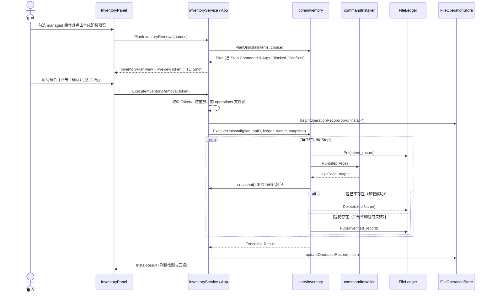

# 安全卸载执行（ExecuteUninstall）架构契约

状态：Type C Phase 2 契约已冻结（决策 A/A/A，2026-10-27）。
依据：AGENTS.md、docs/architecture.md §1/§5/§10、docs/inventory-contract.md §10。

## 1. 范围与边界

| 维度 | 纳入范围 | 排除范围（Out of Scope） | 归属/原因 |
|---|---|---|---|
| **准入范围** | 仅限 `install-ledger.json` 中状态为 `installed` 的 `managed` 项 | `external`（用户自装）与 `unknown`（归属存疑） | 核心层硬阻断，绝不触碰非 Shuttle 受管软件 |
| **渠道支持** | 仅限 `npm`（全局包）与 `winget`（精确 ID） | 注册表 ARP、scoop、choco | 与 D2/D7 保持一致，无样本不写代码 |
| **执行模式** | 必须由 `PlanInventoryRemoval` 签发一次性带 TTL 的预览 Token | 允许无预览直接卸载、跨会话长期 Token | 契约 D8 对称：先审命令后执行，防误点与重放 |
| **持久台账** | 卸载成功后从 `install-ledger.json` 物理删除该包记录 | 级联卸载系统共享运行时（如 Node.js） | 契约 D4：单包仅记当前状态，审计归 `operations/` |
| **进程安全** | 持有 operations 文件锁，执行期间阻止应用退出 | 强制递归杀死外部挂起的第三方安装器 | 与安装流程对齐，保证原子性与状态可追溯 |

---

## 2. 核心架构时序（Mermaid）



---

## 3. 状态转移与三元决策矩阵

卸载执行针对单包的状态机迁移：

| 前置状态 | 卸载器退出码 | 安装后复检快照 | 终态台账动作 | 最终呈现归属 | 备注 |
|---|---|---|---|---|---|
| `installed` | 0 | 包不存在（absent） | 从台账**物理删除** | `absent`（不在列表中） | 卸载彻底完成 |
| `installed` | 0 | 包仍存在（present） | 写入 `unverified` | `unknown` | 卸载器成功但文件未清，需人工核对 |
| `installed` | ≠0 | 包不存在（absent） | 写入 `unverified` | `unknown` | 异常但包没了，保留证据不吞错 |
| `installed` | ≠0 | 包仍存在（present） | 保留并写入错误详情 | `unknown`（阻断二次操作） | 卸载失败，保留原始退出码与报错 |

---

## 4. 接口契约签名

### 4.1 Go Core 契约 (`internal/core/inventory/`)

```go
// Ledger 扩充物理删除能力
type Ledger interface {
    Lookup(name string) (Record, bool, error)
    Put(record Record) error
    Delete(name string) error // 卸载成功后物理移出台账
}

// PlanUninstall 补全命令与 argv
// npm:    "npm uninstall -g <name>", ["npm", "uninstall", "-g", "<name>"]
// winget: "winget uninstall --id <id> --exact", ["winget", "uninstall", "--id", "<id>", "--exact"]
func PlanUninstall(items []Item, choice Choice) (Plan, error)

// ExecuteUninstall 执行受控卸载
func ExecuteUninstall(plan Plan, operationID string, ledger Ledger, install Installer,
    snapshot Snapshot, current PlanSource) (Execution, error)
```

### 4.2 Go 桥接契约 (`main`)

```go
type RemovalPreview struct {
    Token string
    Plan  InventoryPlan
}

func (a *App) PlanInventoryRemoval(names []string) (RemovalPreview, error)
func (a *App) ExecuteInventoryRemoval(previewToken string) (InstallResult, error)
```

### 4.3 前端 TypeScript 契约 (`frontend/src/`)

```typescript
export interface InventoryBackend {
    PlanInventoryRemoval(names: string[]): Promise<RemovalPreview>
    ExecuteInventoryRemoval(previewToken: string): Promise<InstallResult>
}
```

---

## 5. 任务卡拆解（每卡 ≤ 300 行）

- **Card 1：卸载计划命令行生成与台账删除能力** (`core/inventory` + `adapters/inventory`)
  - `PlanUninstall` 产出完整 `Command` 与 `Args`；
  - `FileLedger` 实现 `Delete(name string) error`；
  - 补充 4 个隔离单元测试（npm/winget 卸载命令、只读判定、台账删除幂等）。
- **Card 2：卸载执行核心用例与过期复核** (`internal/core/inventory/execute.go`)
  - 实现 `ExecuteUninstall`，包含 intent 落盘、执行卸载器、复检判定三元组、成功删台账、失败降级 unverified、`stale_plan` 校验；
  - 补充 4 个执行单元测试（执行成功删台账、卸载失败保留记录、stale_plan 拦截）。
- **Card 3：桥接接入、前端预览执行交互与真机验证** (`installs.go` + `InventoryPanel.tsx` + `verify-removal.ps1`)
  - `App.PlanInventoryRemoval` 签发 Token，`App.ExecuteInventoryRemoval` 接管执行并持久化到 `operations/`；
  - 前端展示卸载预览卡片与确认执行按钮；
  - 补充 UIA 自动化验证脚本并在隔离目录下完成实测闭环。

---

## 6. 验收标准

1. `npm test` 与 `go test ./...` 全绿；
2. `scripts/check.ps1` 13 组几何测试全绿（弹窗与扩展区域最小间距 ≥12px）；
3. 真实 exe 运行下：`managed` 包可勾选，生成卸载预览并展示待执行完整命令；
4. 真实/隔离卸载执行通过后，包从台账消失，操作记录写入 `operations/`。
